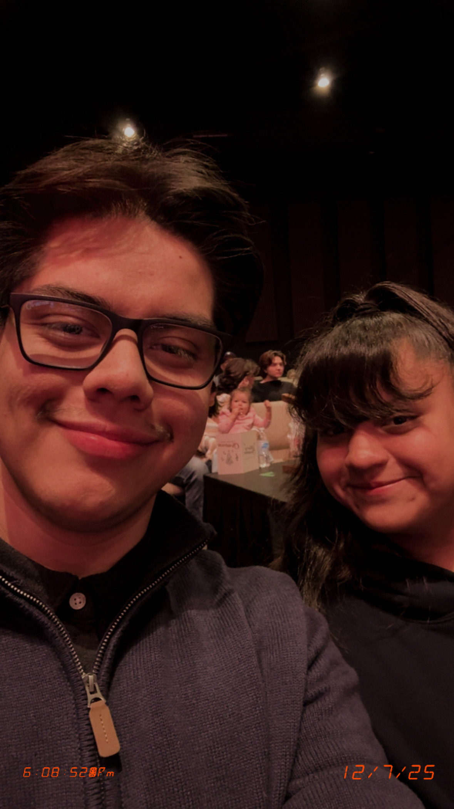

  

    
  

  

  
Hi, I'm Danny Garcia! I'm a Computer Science student based in Los Angeles, California, with a passion for technology and figuring out how things work.

Outside of technology, I enjoy getting outdoors, hiking, running, and working out. I also enjoy meeting new people, learning from their experiences, and exploring new opportunities.

This website is a place where I can share my projects, document what I'm learning, and write about my interests and goals along the way.

  

If you'd like to connect or have questions about my work, feel free to reach out through any of the links below.
